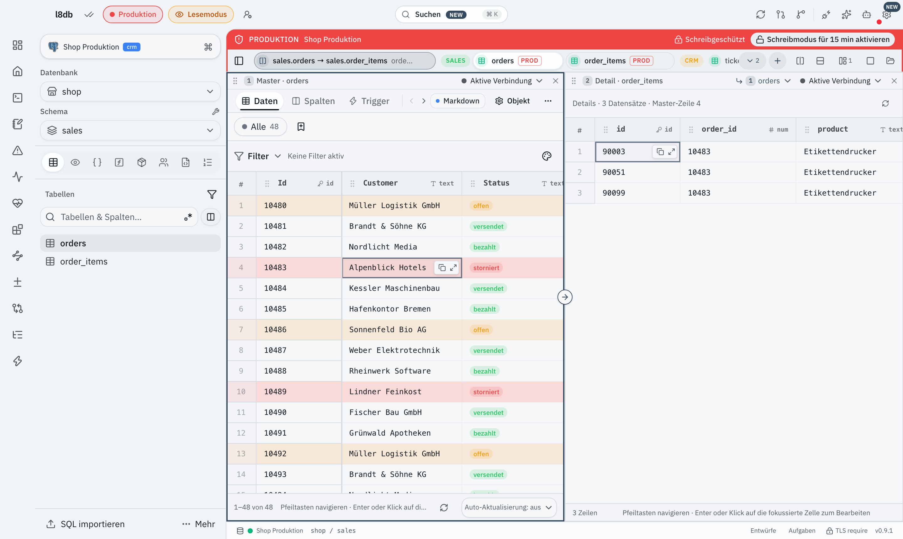
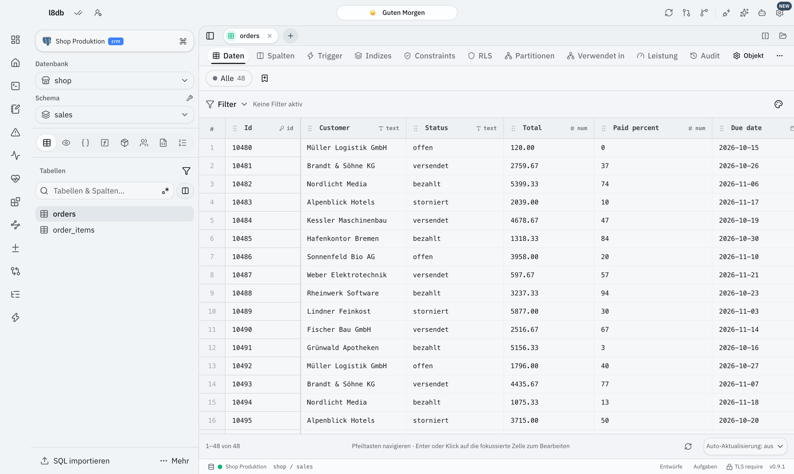
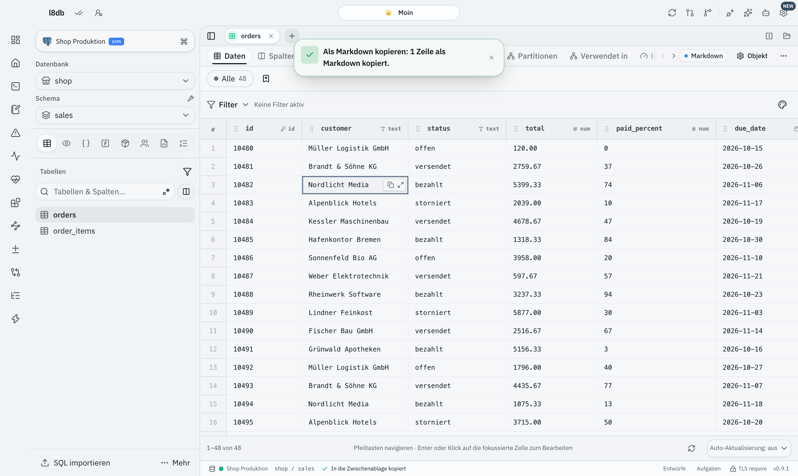
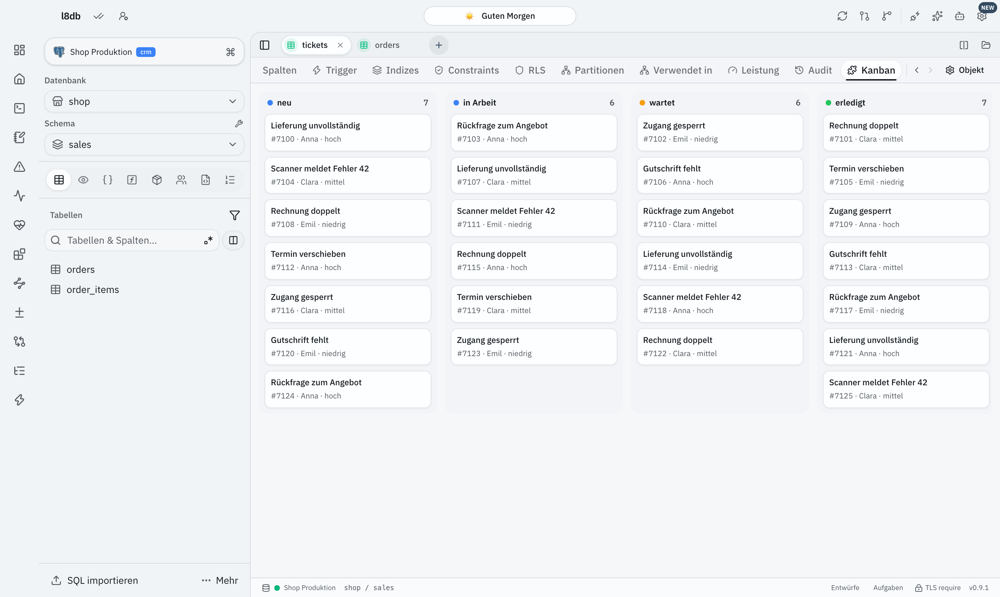
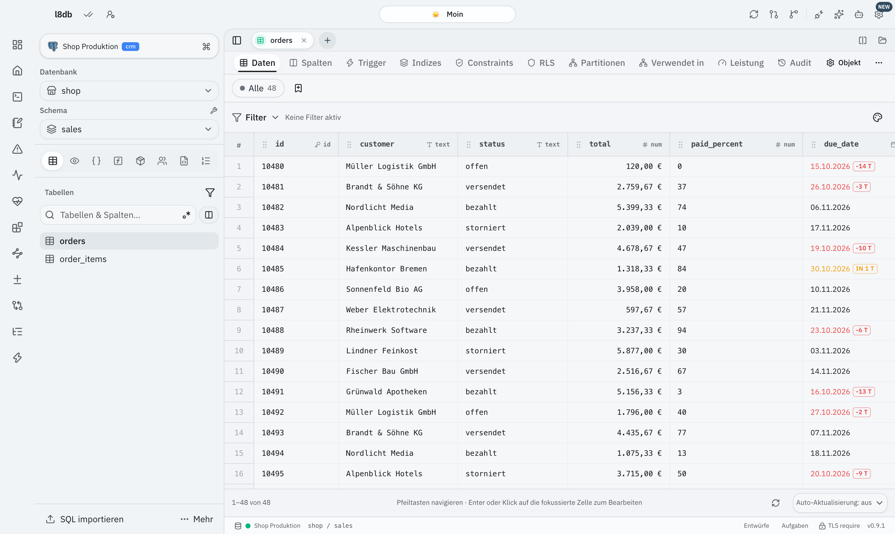
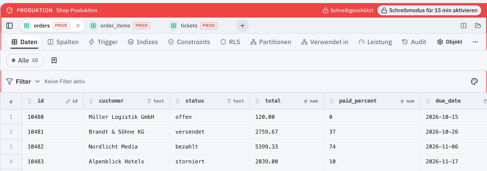
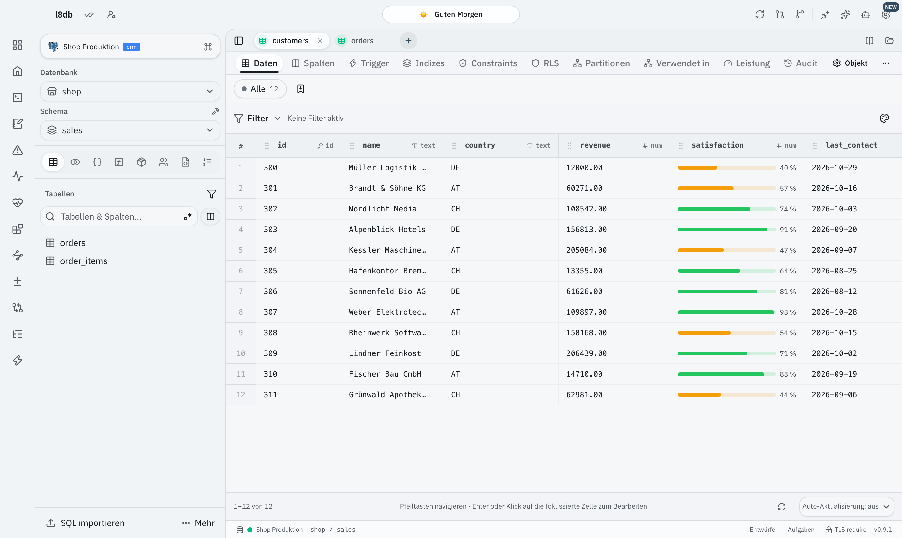
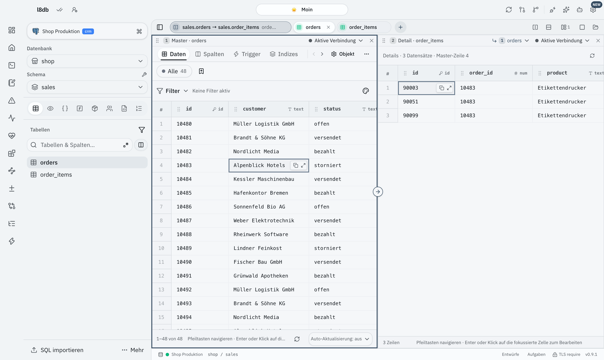
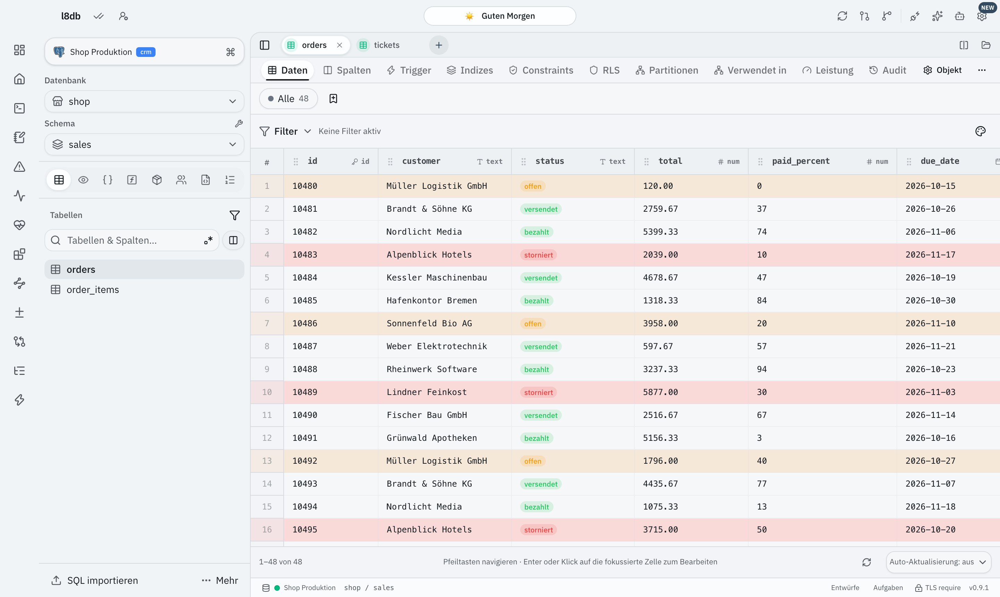
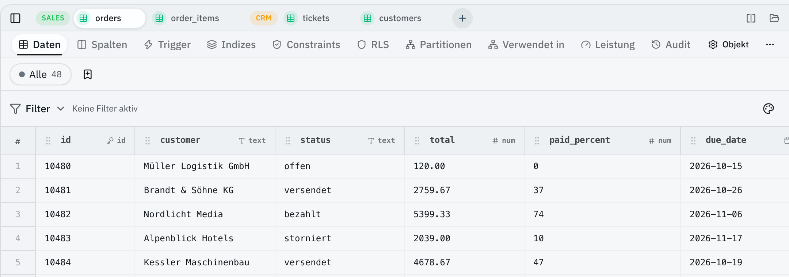

# l8db UI-Plugins

Baue die Oberfläche von [l8db](https://github.com/Leon-Achteresch/l8db) nach deinen Wünschen um. Plugins können Zellen, Spalten und Zeilenfarben ändern, Knöpfe in die Toolbar setzen, eigene Tabs neben „Daten“ und „Spalten“ anlegen und die Tab-Leiste sowie die geteilte Ansicht umgestalten. Ein Plugin ist eine einzige React-Datei. Du schreibst sie selbst oder lässt sie von einer KI schreiben. l8db übernimmt jede Änderung sofort, ohne Neustart.

## Installieren

Öffne in l8db **Einstellungen → Erweiterungen → UI-Plugins**. Die Galerie dort zeigt alle Plugins aus diesem Repo mit Screenshot; ein Klick auf „Installieren“ genügt. Danach schaltest du jedes Plugin an derselben Stelle ein oder aus, stellst seine Optionen ein, aktualisierst oder entfernst es.

Ohne Galerie kopierst du `plugins/<id>/plugin.tsx` unter dem Namen `<id>.tsx` in deinen Plugin-Ordner:

| System | Plugin-Ordner |
|---|---|
| macOS, Linux | `~/.l8db/ui` |
| Windows | `%APPDATA%\.l8db\ui` |

## Mit KI selbst bauen

1. Klicke in l8db unter Einstellungen → Erweiterungen → UI-Plugins auf **Mit KI bauen**. Damit kopierst du eine Anleitung samt Ordnerpfad.
2. Füge sie in deinen KI-Agenten ein (Claude Code, Codex, Cursor …) und beschreibe, was du willst. Zum Beispiel: „Färbe in `sales.orders` überfällige Bestellungen rot und zeig Beträge in Euro.“
3. Die KI arbeitet direkt im Plugin-Ordner. Dort legt l8db `AGENTS.md`, `CLAUDE.md`, `l8db-ui.d.ts` und `tsconfig.json` ab. Fehler stehen mit Zeilennummer in `.status.json`. Jede Änderung siehst du sofort in der App.

Die ganze Anleitung für KIs steht in [`sdk/folder-agents.md`](sdk/folder-agents.md), alle Typen in [`sdk/l8db-ui.d.ts`](sdk/l8db-ui.d.ts).

## Was Plugins ändern können

| Bereich | Slots |
|---|---|
| Tabelle | `grid.cell`, `grid.rowTone`, `grid.columns` |
| Tabellenansicht | `table.toolbar`, `table.detailTabs` |
| Tab-Leiste | `tabs.group`, `tabs.item`, `tabs.options` |
| Split-Ansicht | `split.layout`, `split.options`, `split.templates` |

Mit `options` wird ein Plugin in den Einstellungen von l8db für jede Person einstellbar, ohne dass jemand Code anfassen muss.

## Sicherheit

UI-Plugins laufen im Fenster von l8db, eingeschränkt durch feste Regeln:

- Imports gibt es nur aus `react` und `@l8db/ui`.
- `window`, `document`, `fetch` und `localStorage` sind gesperrt, ebenso `<script>`, `<iframe>` und `<style>`.
- Plugins sehen Zeilen nur als schreibgeschützte Kopien.
- Ins Netz kommt ein Plugin nur über `ctx.http`, und die Person muss das Ziel freigeben.
- Langsame oder fehlerhafte Slots schaltet l8db ab.

Diese Regeln ersetzen keine Sandbox. Sie fangen Versehen ab, aber wer absichtlich tarnt, etwa über berechnete Eigenschaftsnamen, kommt an ihnen vorbei. Darum liest ein Mensch jeden Pull Request, bevor ein Plugin in die Galerie kommt. Beim Installieren vergleicht die Galerie den SHA-256 jeder Datei mit dem Katalog. Installiere nur Plugins, deren Code du gelesen hast oder denen du vertraust.

## Beitragen

1. Repo forken und `bun install` ausführen.
2. Einen Ordner `plugins/<github-name>.<name>/` anlegen, darin `plugin.tsx` und einen eigenen Screenshot aus l8db (`screenshot.png`, `.webp` oder `.jpg`, höchstens 2 MB). Die `id` des Plugins muss dem Ordnernamen entsprechen. Alle Regeln stehen in [AGENTS.md](AGENTS.md).
3. `bun run readme`, `bun run check` und `bun test scripts` ausführen. Der Check übersetzt jedes Plugin, ruft alle Slots mit den Beispieldaten aus `scripts/samples.ts` und jeder Optionsvariante auf, misst `grid.cell` und rendert jede Ausgabe. Die von `bun run readme` aktualisierte Plugin-Liste gehört mit in den Pull Request.
4. Einen Pull Request öffnen. Nach dem Merge veröffentlicht GitHub Actions den Katalog im Branch `catalog`, und das Plugin erscheint in der Galerie.

## Plugins

<!-- plugins:start -->

### Spalten-Vorgaben

`l8db.column-presets` · Tabelle · [Quelltext](plugins/l8db.column-presets/plugin.tsx)

Heftet Primärschlüssel links an, blendet technische Spalten aus und zeigt lesbare Spaltennamen. Eigene Anpassungen in l8db gehen immer vor.

### Als Markdown kopieren

`l8db.copy-as-markdown` · Toolbar & Tabs · [Quelltext](plugins/l8db.copy-as-markdown/plugin.tsx)

Fügt jeder Tabelle einen Knopf hinzu, der markierte oder geladene Zeilen als Markdown-Tabelle kopiert – fertig für Tickets, Wikis und Chats.

### Kanban-Board

`l8db.kanban` · Toolbar & Tabs · [Quelltext](plugins/l8db.kanban/plugin.tsx)

Fügt Tabellen mit Statusspalte einen Tab „Kanban“ hinzu: Zeilen als Karten, gruppiert nach Status.

### Beträge und Datum

`l8db.money-and-dates` · Tabelle · [Quelltext](plugins/l8db.money-and-dates/plugin.tsx)

Formatiert Geldbeträge als Währung, zeigt Zeitpunkte relativ an und markiert überfällige oder bald fällige Termine.

### Produktions-Warnung im Tab

`l8db.prod-tab-warning` · Tab-Leiste · [Quelltext](plugins/l8db.prod-tab-warning/plugin.tsx)

Markiert jeden Tab einer Produktionsverbindung mit einem roten Hinweis, Staging auf Wunsch gelb. So arbeitet niemand versehentlich live.

### Fortschrittsbalken

`l8db.progress-bars` · Tabelle · [Quelltext](plugins/l8db.progress-bars/plugin.tsx)

Zeigt Prozent-, Quoten- und Zufriedenheitsspalten als Balken mit Ampelfarben statt als nackte Zahl.

### Split-Arbeitsplatz

`l8db.split-workbench` · Split-Ansicht · [Quelltext](plugins/l8db.split-workbench/plugin.tsx)

Ordnet geteilte Ansichten an, legt nicht für jede Teilung eine Gruppe an und bringt Master-Detail-Vorlagen mit: Auswahl links filtert die Bereiche rechts.

### Status als Pills

`l8db.status-pills` · Tabelle · [Quelltext](plugins/l8db.status-pills/plugin.tsx)

Zeigt Status- und Prioritätsspalten als farbige Pills. Auf Wunsch werden auch ganze Zeilen nach ihrem Status eingefärbt.

### Tabs nach Schema

`l8db.tab-groups` · Tab-Leiste · [Quelltext](plugins/l8db.tab-groups/plugin.tsx)

Gruppiert Tabellen-Tabs nach Schema mit farbigem Label, öffnet neue Tabs neben dem aktiven und steuert den Schließen-Knopf.

<!-- plugins:end -->

## Lizenz

[Apache-2.0](LICENSE)
